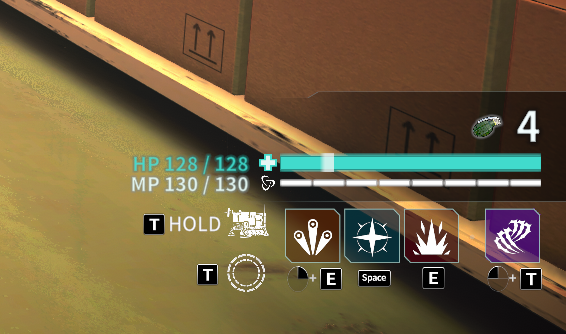
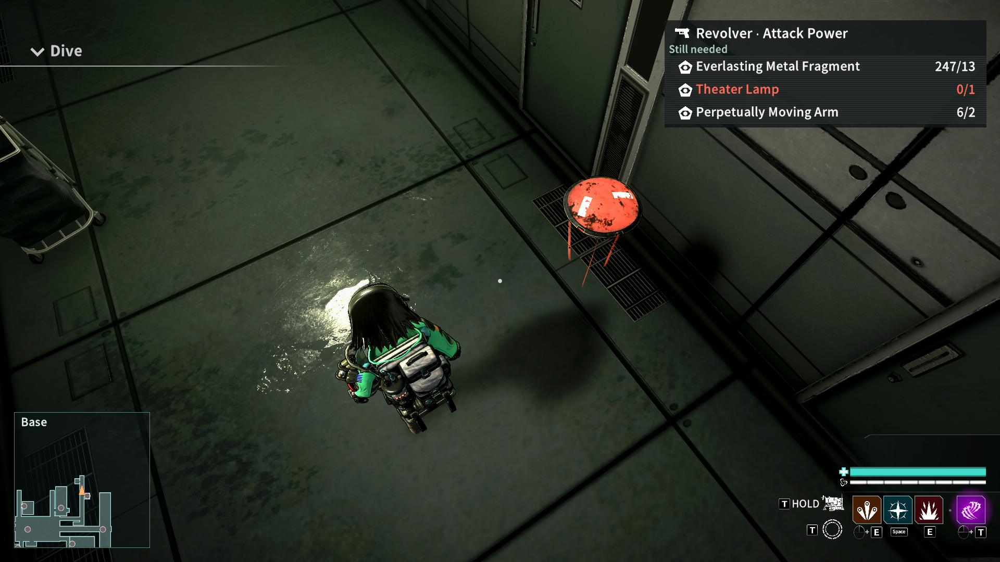
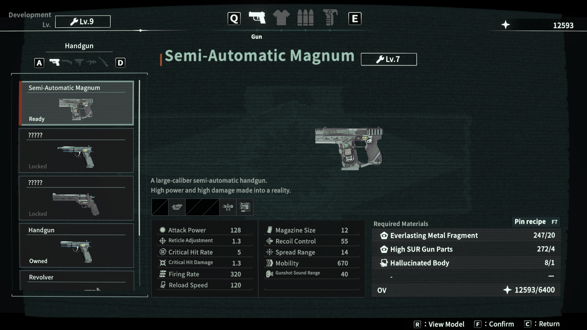
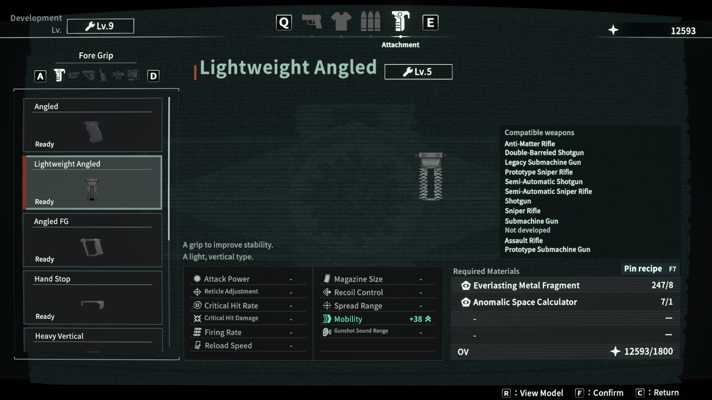
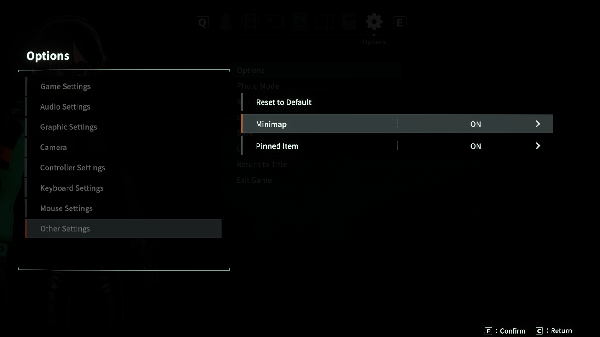

# ANOMALITH Mods

BepInEx mods for the Windows x64 Unity Mono build of [ANOMALITH on Steam](https://store.steampowered.com/app/4017880/ANOMALITH/).

## Quick install

1. Open the folder containing `Anomalith.exe`. In Steam, right-click ANOMALITH and choose **Manage → Browse local files**.
2. If needed, extract [BepInEx 5.4.23.6 for Windows x64](https://github.com/BepInEx/BepInEx/releases/tag/v5.4.23.6) into that folder. Launch the game once, then close it.
3. With the game closed, extract the [v1.0.7 release ZIP](https://github.com/dienp/anomalith-mods/releases/download/v1.0.7/anomalith-mods-v1.0.7.zip) into the folder containing `Anomalith.exe`. To install just one mod, copy its standalone DLL into `BepInEx/plugins`.
4. Launch the game. BepInEx loads the mods automatically.

If upgrading from v1.0.1 or v1.0.2, remove the old Minimap and Upgrade Tracker DLLs from `BepInEx/scripts` to avoid loading duplicates.

## Compatibility

Future releases will list the tested ANOMALITH Steam Build ID alongside the
mod suite version and the checks performed. Look for the same compatibility
note here, in the release notes, and on [Nexus Mods](https://www.nexusmods.com/anomalith/mods/10).

## Mods

| Mod | What it does |
| --- | --- |
| [Upgrade Tracker](mods/upgrade-tracker/README.md) | Pins Workshop recipes, highlights material sources on Deploy, and shows which weapons fit the highlighted Workshop attachment. The pinned checklist hides during OV gain notifications. |
| [Minimap](mods/minimap/README.md) | Shows the native floor plan, player position, and points of interest during gameplay. Hides during NPC and radio conversations. Other Settings includes a Minimap Size slider. |
| [HUD Numbers](mods/hud-numbers/README.md) | Shows current and maximum HP and MP beside the HUD bars. Toggle HP/MP Numbers in Other Settings. |
| [Auto Reload](mods/auto-reload/README.md) | Starts a normal reload when the equipped firearm runs empty and spare ammo is available. Toggle it in **Options → Other Settings**. |
| [Quick Weapon Switch](mods/quick-switch/README.md) | Speeds up weapon swaps and cycles assigned weapons on the first scroll notch. Use **Options → Other Settings** for the ON/OFF toggle and **Switch Speed** slider (1.0×–3.0×, default 1.5×). |
| [Inventory Storage Preview](mods/storage-preview/README.md) | Shows the Storage icon and Base storage count when hovering over an item in Inventory. Toggle it in **Options → Other Settings**. |

## Screenshots

### HP and MP numbers



### Minimap and upgrade checklist



### Pin a Workshop recipe



### Attachment compatibility



### Visibility settings



## Build from source

Install the workspace dependencies with `npm ci` at the `game-mods` root. Set
`AnomalithDir` to a local ANOMALITH installation with BepInEx 5.

```powershell
$env:AnomalithDir = 'E:/Games/ANOMALITH'
npx nx run-many -t build --projects=tag:game:anomalith
npx nx run-many -t spec --projects=tag:game:anomalith
```

Build one mod with `npx nx build anomalith-minimap`. Release DLLs are under
`anomalith/mods/<mod>/bin/Release/netstandard2.1/` and go in
`BepInEx/plugins`. Use `npm run spec -- mods/minimap <args>` to run other
OpenSpec commands in that mod.

### Hot reload during development

Set up ScriptEngine 11.2 in the local BepInEx installation. Remove any installed
release copy of the mod you are developing so ScriptEngine loads a single copy.
Then run `npx nx run anomalith-minimap:dev`. The watcher rebuilds on source
changes and copies the Debug DLL to `BepInEx/scripts` for ScriptEngine to reload.
