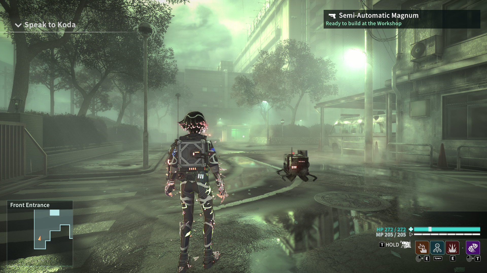
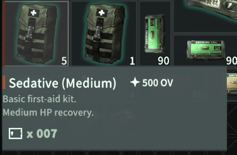

# ANOMALITH Mods

BepInEx mods for the Windows x64 builds of [ANOMALITH on Steam](https://store.steampowered.com/app/4017880/ANOMALITH/).

## Compatibility

ANOMALITH Mods v1.0.9 targets Windows x64 Unity IL2CPP. Testing used
BepInEx 6.0.0-be.793 on Steam build `26773190`. The Quick Weapon Switch
1.0.3 fix was verified in a hot-reloaded Debug build. One scroll notch
switched weapons in either direction with the wheel closed. Turning the
mod off restored the stock wheel. Swap-speed timing and Auto Reload
gameplay checks are pending. See the [compatibility test record](docs/compatibility-26773190.md).

## Quick install for v1.0.9 on IL2CPP

1. Find `Anomalith.exe` in **Steam → Manage → Browse local files**.
2. Install [BepInEx 6 IL2CPP for Windows x64](https://docs.bepinex.dev/master/articles/user_guide/installation/unity_il2cpp.html)
   in that folder. Use a clean loader installation if upgrading from BepInEx 5.
   Launch the game once with no plugins and close it after the title screen.
3. Extract `anomalith-mods-v1.0.9-il2cpp.zip` into the folder containing
   `Anomalith.exe`. For an individual install, copy its DLL into `BepInEx/plugins`.
   Remove older copies of the ANOMALITH mods from `BepInEx/plugins` and `BepInEx/scripts`.
4. Launch the game and check **Options → Other Settings** for mod controls.

## Quick install for the published Mono release

The published v1.0.7 ZIP targets Windows x64 Unity Mono with BepInEx 5.

1. Open the folder containing `Anomalith.exe`. In Steam, right-click ANOMALITH and choose **Manage → Browse local files**.
2. If needed, extract [BepInEx 5.4.23.6 for Windows x64](https://github.com/BepInEx/BepInEx/releases/tag/v5.4.23.6) into that folder. Launch the game once, then close it.
3. With the game closed, extract the [v1.0.7 release ZIP](https://github.com/dienp/anomalith-mods/releases/download/v1.0.7/anomalith-mods-v1.0.7.zip) into the folder containing `Anomalith.exe`. To install just one mod, copy its standalone DLL into `BepInEx/plugins`.
4. Launch the game. BepInEx loads the mods automatically.

If upgrading from v1.0.1 or v1.0.2, remove the old Minimap and Upgrade Tracker DLLs from `BepInEx/scripts` to avoid loading duplicates.

## Mods

| Mod | What it does |
| --- | --- |
| [Upgrade Tracker](mods/upgrade-tracker/README.md) | Pins Workshop recipes, highlights material sources on Deploy, and shows which weapons fit the highlighted Workshop attachment. The pinned checklist hides during OV gain notifications. |
| [Minimap](mods/minimap/README.md) | Shows the native floor plan, player position, and points of interest during gameplay. Hides during NPC and radio conversations. Other Settings includes a Minimap Size slider. |
| [HUD Numbers](mods/hud-numbers/README.md) | Shows current and maximum HP and MP beside the HUD bars. Toggle HP/MP Numbers in Other Settings. |
| [Auto Reload](mods/auto-reload/README.md) | Starts a normal reload when the equipped firearm runs empty and spare ammo is available. Toggle it in **Options → Other Settings**. |
| [Quick Weapon Switch](mods/quick-switch/README.md) | Speeds up weapon swaps and cycles assigned weapons on the first scroll notch. Use **Options → Other Settings** for the ON/OFF toggle and **Switch Speed** slider (1.0×–3.0×, default 1.5×). |
| [Inventory Storage Preview](mods/storage-preview/README.md) | Shows the Storage icon and Base storage count when hovering over an item in Inventory. Toggle it in **Options → Other Settings**. |

## Screenshots

### HP and MP numbers



### Inventory storage count



### Minimap and upgrade checklist


### Pin a Workshop recipe


### Attachment compatibility


### Visibility settings


## Build from source

Install the workspace dependencies with `npm ci` at the `game-mods` root.
Set `AnomalithDir` to the folder that contains `Anomalith.exe`.

- For Mono, install BepInEx 5.4.23.6. Set `AnomalithDir` to that installation.
- For IL2CPP, install [BepInEx 6 IL2CPP Windows x64](https://docs.bepinex.dev/master/articles/user_guide/installation/unity_il2cpp.html).
  Launch the game once with an empty plugins folder to generate `BepInEx/interop`.
  Build against the same installation.

```powershell
$env:AnomalithDir = 'E:/Games/ANOMALITH.Build.26773190'
npx nx run-many -t build --projects=tag:game:anomalith
npx nx run-many -t spec --projects=tag:game:anomalith
```

Build one mod with `npx nx build anomalith-minimap`. Each mod's
`bin/Release/netstandard2.1/` contains the Mono DLL and `bin/Release/net6.0/`
contains the IL2CPP DLL. Install the DLL for your runtime in `BepInEx/plugins`.
Use `npm run spec -- mods/minimap <args>` to run other OpenSpec commands.

### Hot reload during development

Set `AnomalithDir` to the development game installation and start the mod's
watcher, for example `npx nx run anomalith-upgrade-tracker:dev`.

- **Mono:** Set up ScriptEngine 11.2. Remove the mod's startup copy from
  `BepInEx/plugins` so ScriptEngine loads a single copy. The watcher deploys
  Debug builds to `BepInEx/scripts`.
- **IL2CPP:** With the game closed, replace the mod's Release DLL in
  `BepInEx/plugins` with the first `bin/Debug/net6.0/` build. Launch the game
  once to start the Debug loader. The watcher deploys subsequent builds to
  `BepInEx/development`, where the running plugin picks them up. Check
  `BepInEx/LogOutput.log` for the `Hot reloaded` entry after each build.

Use `nx build` to produce Release DLLs. The IL2CPP hot-reload loader is
compiled only into Debug builds.

To verify IL2CPP hot reload in a running Debug session, run
`.\anomalith\scripts\Test-Il2CppReload.ps1 -AnomalithDir $env:AnomalithDir`.
The check updates each development DLL's timestamp and waits for a new
reload log entry in the same game process.
